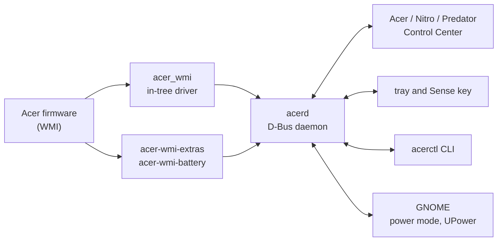

<p align="center">&nbsp;&nbsp;&nbsp;&nbsp;</p>

<h1 align="center">acerctl</h1>

<p align="center"><b>AcerSense, NitroSense and PredatorSense for Linux</b><br>
One daemon, app and CLI for operating modes, fans, battery, keyboard and sensors, showing only what your laptop's firmware offers.<br>
<sub>Independent open-source project, not affiliated with Acer.</sub></p>

<p align="center">
<a href="https://github.com/FnnDK/acerctl/actions/workflows/ci.yml"></a>
<a href="https://github.com/FnnDK/acerctl/releases/tag/v0.1.5"></a>
<a href="#license"></a>


</p>

<p align="center">
<a href="#acer"></a>
<a href="#nitro"></a>
<a href="#predator"></a>
</p>

<p align="center">
<a href="#features">Features</a> ·
<a href="#download">Download</a> ·
<a href="#screenshots">Screenshots</a> ·
<a href="#tested-models">Tested models</a> ·
<a href="#compared-with-other-tools">Compared</a> ·
<a href="#gnome-integration">GNOME</a> ·
<a href="#how-it-works">How it works</a> ·
<a href="#building-from-source">Build</a> ·
<a href="#license">License</a>
</p>

<p align="center"></p>

## Overview

Acer ships a different Windows-only app per product line. The laptops themselves share the same Acer WMI firmware interfaces (the ones the kernel's `acer_wmi` driver already uses across product lines), so acerctl covers all three with a single stack: each feature shows up only if the machine's firmware reports it, with no per-brand switch and no hard-coded model list. The app comes in three flavors built from the same code, differing only in name and colors; the installer picks one from the product name.

| | App | Instead of | Laptops | Status |
|:-:|---|---|---|---|
|  | [**Acer Control Center**](#acer) | AcerSense | Aspire, Swift, TravelMate, Extensa |  working: Aspire AG15-71P |
|  | [**Nitro Control Center**](#nitro) | NitroSense | Nitro |  working: Nitro ANV15-52, the reference machine |
|  | [**Predator Control Center**](#predator) | PredatorSense | Predator |  untested: built from public reports |

> [!TIP]
> Your model is not on the list? Run the read-only [hardware report](docs/hardware-reports.md) and open a *Hardware report* issue: that is all we need to start supporting it.

## Features

<table>
<tr>
<td width="50%" valign="top">⚡ <b>Operating modes</b><br>Eco, Quiet, Balanced, Performance and Turbo, limited to the profiles the firmware supports, with the original app's AC/battery rules and in sync with the desktop's power mode.</td>
<td width="50%" valign="top">🌀 <b>Fans</b><br>CPU and GPU fans in auto, max or manual speed.</td>
</tr>
<tr>
<td valign="top">📊 <b>Monitor</b><br>Temperatures, usage, clocks, power, fan speed, RAM and network, without waking the discrete GPU when it is powered off.</td>
<td valign="top">🔋 <b>Battery</b><br>80 % charge limit (the same switch as GNOME's), calibration, health, cycles, temperature, voltage and current.</td>
</tr>
<tr>
<td valign="top">⌨️ <b>Keyboard and USB</b><br>Backlight auto-off timeout; charge USB devices while the laptop is off.</td>
<td valign="top">🎮 <b>Scenarios and App Sync</b><br>Mode, fans and keyboard saved together and applied when a game or program starts (Wine/Proton too), then undone when it exits.</td>
</tr>
<tr>
<td valign="top">🔘 <b>Sense key</b><br>The AcerSense/NitroSense/PredatorSense button opens the app or cycles the modes.</td>
<td valign="top">🔁 <b>Tray, CLI and restore</b><br>State restored at boot and after suspend; a tray icon and the <code>acerctl</code> CLI next to the app.</td>
</tr>
</table>

## Download

Latest: **[0.1.5](https://github.com/FnnDK/acerctl/releases/tag/v0.1.5)** (pre-release), ready-built packages for **Fedora 44** (Workstation and the Atomic desktops: Silverblue, Kinoite, Bluefin) and **Debian 13, Ubuntu 24.04 and 26.04**. Pick your laptop's product line below: each one gets the app with its own name and colors, on top of the same daemon and kernel modules. The kernel modules are rebuilt for every new kernel (akmod on Fedora, DKMS on Debian/Ubuntu) and signed with the local key when Secure Boot needs it; the daemon starts by itself when the app or the tray first needs it.

> [!IMPORTANT]
> Run the commands on the host, not inside a toolbox or distrobox: there `sudo` only reaches the container.

> [!NOTE]
> The .deb packages are new and so far tested in containers only. Another distribution? See [Building from source](#building-from-source).

[`install.sh`](packaging/install.sh) downloads the release's packages, checks them against its `SHA256SUMS` and installs them with `dnf`, `rpm-ostree` or `apt`; `--no-gui` leaves out the app and the tray (the daemon, the CLI and the kernel modules only), and `sh install.sh -n` shows what it would do without changing anything. Then see [After installing](#after-installing). To upgrade, run the same commands again (on Silverblue, Kinoite and Bluefin, then reboot once): it replaces an earlier version and an install made with the scripts.

### &nbsp;Acer

Aspire, Swift, TravelMate, Extensa and the other non-gaming lines: **Acer Control Center**.  Tested on the Aspire AG15-71P (charge limit, Sense key, app and tray).

<details>
<summary>&nbsp; Workstation, Silverblue, Kinoite, Bluefin</summary>

```bash
curl -fLO https://raw.githubusercontent.com/FnnDK/acerctl/main/packaging/install.sh
sudo sh install.sh --acer
```

</details>

<details>
<summary>&nbsp;</summary>

```bash
wget -nv -O install.sh https://raw.githubusercontent.com/FnnDK/acerctl/main/packaging/install.sh
sudo sh install.sh --acer
```

</details>

### &nbsp;Nitro

**Nitro Control Center** for the Nitro line.  Tested on the Nitro ANV15-52 (modes, fans, sensors, keyboard, USB charging, battery, scenarios).

<details>
<summary>&nbsp; Workstation, Silverblue, Kinoite, Bluefin</summary>

```bash
curl -fLO https://raw.githubusercontent.com/FnnDK/acerctl/main/packaging/install.sh
sudo sh install.sh --nitro
```

</details>

<details>
<summary>&nbsp;</summary>

```bash
wget -nv -O install.sh https://raw.githubusercontent.com/FnnDK/acerctl/main/packaging/install.sh
sudo sh install.sh --nitro
```

</details>

### &nbsp;Predator

**Predator Control Center** for the Predator line.  Not tested on a Predator yet: the features come from the firmware, and a [hardware report](docs/hardware-reports.md) from your machine helps a lot.

<details>
<summary>&nbsp; Workstation, Silverblue, Kinoite, Bluefin</summary>

```bash
curl -fLO https://raw.githubusercontent.com/FnnDK/acerctl/main/packaging/install.sh
sudo sh install.sh --predator
```

</details>

<details>
<summary>&nbsp;</summary>

```bash
wget -nv -O install.sh https://raw.githubusercontent.com/FnnDK/acerctl/main/packaging/install.sh
sudo sh install.sh --predator
```

</details>

### After installing

Open the app: on its first start it lists what is still missing and applies it with one password and one restart. That is the `acer_wmi` option Nitro and Predator models need for operating modes and fans, and, with Secure Boot, enrolling the key that signs the kernel modules (akmods on Fedora, DKMS on Debian/Ubuntu). Without the app (`install.sh --no-gui`), `acerctl setup` lists the same steps and `acerctl setup apply` makes them. `acerctl status` shows what the daemon found and `acerctl help` lists the commands.

By hand, the `acer_wmi` option for the Nitro ANV15-52 is (`/etc/modprobe.d/acer-wmi.conf`, then reboot):

```
options acer_wmi predator_v4=1 force_caps=0x1C26
```

> [!WARNING]
> Before enabling `platform-profile`, check the `tuned`/`power-profiles-daemon` profile: Linux's `performance` mode maps to Acer's Turbo, which not every model has.

The kernel decides part of it: `acer_wmi` exposes the operating modes from Linux 6.9 and fan control from 6.19. The companion modules build from 5.15 on.

| Kernel | Operating modes | Fan control |
|---|:-:|:-:|
| Fedora 44, Ubuntu 26.04, Ubuntu 24.04 with the HWE kernel |  |  |
| Debian 13 (6.12) |  |  |
| Ubuntu 24.04 with its original kernel (6.8) |  |  |

### Uninstalling

To remove everything acerctl put on the machine, for example to try another tool: the packages (`dnf`, `rpm-ostree`, `apt`), an install made with the scripts and the ones under the project's earlier names (`nitrod`/`nitroctl`/`nitro-tray`, `nitrosensed`). Run it on the host, from the repository or downloaded on its own:

```bash
curl -LO https://raw.githubusercontent.com/FnnDK/acerctl/main/packaging/uninstall.sh
sudo sh uninstall.sh            # keeps your settings (/var/lib/acerd, ~/.config/acerctl)
sudo sh uninstall.sh --purge    # also removes them, the app data and /etc/modprobe.d/acerctl.conf
```

`dnf` and `apt` ask before removing the packages; on Silverblue, Kinoite and Bluefin they go with the next reboot. Inside a toolbox/distrobox shell `sudo` only reaches the container, so the script refuses to run there (use `distrobox-host-exec sudo sh uninstall.sh`). An `acer_wmi` option you wrote yourself in `/etc/modprobe.d` is left in place.

## Screenshots

The app uses its own dark theme, with an integrated title bar that follows GNOME's button order and icons, and texts in Portuguese and English.

<details open>
<summary>&nbsp;<b>Nitro Control Center</b> (the dashboard is at the top of the page)</summary>

| | |
|---|---|
|  |  |
|  |  |
|  |  |

<sub>Daemon in simulated mode (`acerd --simulate ANV15-52`).</sub>

</details>

<details>
<summary>&nbsp;<b>Acer Control Center</b></summary>


| | |
|---|---|
|  |  |
|  | |

<sub>Aspire AG15-71P, real machine with the daemon in read-only mode (`acerd --dry-run`). Its firmware has no operating modes, fans or keyboard backlight, so those screens and cards do not show up.</sub>

</details>

<details>
<summary>&nbsp;<b>Predator Control Center</b></summary>


| | |
|---|---|
|  |  |
|  |  |
|  |  |

<sub>Daemon in simulated mode (`acerd --simulate PHN16-72`: a Predator with 5 modes, a 4-zone RGB keyboard and an RGB logo, modelled on public reports; no Predator has been tested yet).</sub>

</details>

## Tested models

On the laptops acerctl has been run on:  works,  the laptop has it but acerctl does not handle it yet,  the firmware does not offer it.

| Model | Modes | Fans | Kbd timeout | 80 % limit | Calibration | Sensors | USB charging off | AC/battery rules | GUI | Boot sound | LCD overdrive | RGB | Scenarios | Sense key | Overclock |
|---|:-:|:-:|:-:|:-:|:-:|:-:|:-:|:-:|:-:|:-:|:-:|:-:|:-:|:-:|:-:|
| **Nitro&nbsp;ANV15&#8209;52**<br><sub>BIOS V1.31 · Fedora Silverblue 44</sub> |  |  |  | ¹ | ² |  |  |  |  |  |  |  |  |  |  |
| **Aspire&nbsp;AG15&#8209;71P**<br><sub>BIOS V1.13 · Bluefin 44</sub> |  |  |  | ¹ | ² | ³ |  |  |  |  |  |  | ⁴ |  |  |

¹ Also in GNOME's Power settings ("Preserve Battery Health"). ² The firmware offers it and acerctl exposes it; a full calibration cycle has not been run yet. ³ CPU temperature and the battery sensors; this model has no fan readings and no discrete GPU. ⁴ Nothing for a scenario to set without modes, fans or keyboard backlight.

Both, plus a Predator PH16-71 built from public reports, are also checked automatically on every change: the packages installed in Fedora 44 and Ubuntu 24.04 run against a copy of what each laptop exposes ([`daemon/README.md`](daemon/README.md#known-models), "Known models"). A [hardware report](docs/hardware-reports.md) from another model is how it gets added.

## Compared with other tools

Projects with the most features first; features covered by the most projects on the left.

| Project | Modes | Fans | Kbd timeout | 80 % limit | Calibration | Sensors | USB charging off | AC/battery rules | GUI | Boot sound | LCD overdrive | RGB | Keeps `acer_wmi` | Scenarios | Sense key | Overclock |
|---|:-:|:-:|:-:|:-:|:-:|:-:|:-:|:-:|:-:|:-:|:-:|:-:|:-:|:-:|:-:|:-:|
| Acer NitroSense / PredatorSense<br><sub>Windows only</sub> |  |  | ¹ |  |  |  |  |  |  |  |  | ¹ |  |  |  | ¹ |
| **acerctl**<br><sub>this project</sub> | ² |  |  | ³ |  |  |  |  |  |  |  |  |  |  |  |  |
| [Linuwu-Sense](https://github.com/0x7375646F/Linuwu-Sense)<br><sub>kernel module</sub> |  |  |  |  |  |  |  |  |  |  |  |  |  |  |  |  |
| [predator-sense](https://github.com/wobqqq/predator-sense)<br><sub>CLI + DKMS on Linuwu-Sense</sub> |  |  |  |  |  |  |  |  |  |  |  |  |  |  |  |  |
| [Div-Acer-Manager-Max](https://github.com/PXDiv/Div-Acer-Manager-Max)<br><sub>GUI + daemon on Linuwu-Sense</sub> |  |  |  |  |  |  |  |  |  |  |  |  |  |  |  |  |
| `acer_wmi`<br><sub>in-tree kernel driver</sub> | ⁴ | ⁴ |  |  |  |  |  |  |  |  |  |  |  |  |  |  |
| [acer-wmi-battery](https://github.com/frederik-h/acer-wmi-battery)<br><sub>kernel module</sub> |  |  |  |  |  |  |  |  |  |  |  |  |  |  |  |  |

¹ Where the model has it. ² Only the profiles the firmware reports, synced with `power-profiles-daemon`/`tuned`. ³ Shared with GNOME/UPower. ⁴ A fixed list of 5 profiles, without reading the firmware mask; fan control only with the model quirk or `force_caps`.

Sensors: CPU/GPU temperatures and fan speed. acerctl also has a CLI, a tray, a monitor that does not wake the dGPU and the state restored at boot and after suspend; RGB, boot sound, LCD overdrive and overclocking are not there yet.

<sub>Third-party features as listed in each project's README (October 2026).</sub>

## GNOME integration

acerctl doesn't replace GNOME's own power controls. It stays in sync with them, so you can use either side.

### ⚡ Power mode

GNOME's power mode menu (quick settings and Settings → Power) talks to `power-profiles-daemon` or `tuned-ppd`. `acerd` keeps that profile in sync with the Acer mode in both directions. The app has 5 modes and GNOME has 3, so the mapping is many-to-one going to GNOME. Coming back, the power source decides the mode. A mode the firmware doesn't report (e.g. Turbo on the ANV15-52) is never picked.

**App → GNOME**

| App mode | GNOME power mode |
|---|---|
| Eco | Power Saver |
| Quiet | Power Saver |
| Balanced | Balanced |
| Performance | Performance |
| Turbo | Performance |

**GNOME → app**

| GNOME power mode | On AC | On battery |
|---|---|---|
| Power Saver | Quiet | Eco |
| Balanced | Balanced | Balanced |
| Performance | Turbo when allowed (supported, battery ≥ 40 %), otherwise Performance | Performance (flagged as extra) when battery ≥ 40 %, otherwise Balanced |

When the app changes the mode, it sets the GNOME profile first, waits for `tuned` to apply it, and then writes the real Acer mode. This avoids loops. Details are in [`docs/api-dbus.md`](docs/api-dbus.md) §11.

### 🔋 Battery health

`acer-wmi-battery` exposes the 80 % limit through the standard `charge_control_end_threshold` attribute (kernel ≥ 6.15). UPower therefore sees it, and GNOME shows its own **Settings → Power → Preserve Battery Health** switch. That switch and the app's 80 % limit are the same setting:

- Turning on "Preserve Battery Health" in GNOME sets the 80 % limit, and the app shows it on the next refresh.
- The app's limit goes through UPower when it's available, so GNOME's switch follows it and UPower doesn't revert it at startup. Without UPower, `acerd` writes the firmware directly.
- The limit is either 80 % or off (100 %). The firmware has no other values and no start threshold.

Tested with UPower 1.91.5 on Fedora 44.

## How it works

acerctl works **by complementing the in-tree `acer_wmi` driver** instead of replacing it: what the kernel lacks comes from small companion modules, a daemon applies the rules, and the app, the tray and the CLI talk to it over D-Bus.



| Directory | What it is |
|---|---|
| `gui/` | **Acer / Nitro / Predator Control Center** (Go + Wails, WebKitGTK): the graphical app, one code in three flavors. Details in [`gui/README.md`](gui/README.md). |
| `daemon/` | **`acerd`** (Go): D-Bus service `io.github.fnndk.Acerd1` on the system bus, with polkit; power, fan, lighting, battery, monitor, scenario and App Sync rules. API in [`docs/api-dbus.md`](docs/api-dbus.md). Includes the **`acerctl`** CLI. |
| `drivers/acer-wmi-extras/` | Companion module (GPL): keyboard backlight timeout, USB charging while the laptop is off, the thermal profiles the firmware actually supports, battery sensors. |
| `drivers/acer-wmi-battery/` | Charge limit (80 %) and calibration, vendored from Frederik Harwath's project with one fix ([`UPSTREAM.md`](drivers/acer-wmi-battery/UPSTREAM.md)). |
| `drivers/acer-wmi-lab/` | Research module that calls WMI methods through `sysfs`; only for mapping firmware. |
| `packaging/` | systemd units, D-Bus policy, polkit actions and install scripts. |

Mainline layer used: `acer_wmi` with `predator_v4=1` (profiles in `platform-profile`, fans and temperatures in hwmon) and, until the model's quirk lands upstream, `force_caps=0x1C26` to unlock manual fan control.

### 📚 Documentation

- [`STATUS.md`](STATUS.md): project state, what has been done and next steps.
- [`docs/firmware-wmi.md`](docs/firmware-wmi.md): technical reference for the firmware (WMI classes, formats, capabilities).
- [`docs/api-dbus.md`](docs/api-dbus.md): `acerd` D-Bus API.
- [`docs/hardware-reports.md`](docs/hardware-reports.md): how to send a report from a new model.

## Building from source

For other distributions, or to build from the repository. The scripts install to `/usr/local`, `/etc` and `/var/lib` (writable on Silverblue too); the reference machine is an Acer Nitro ANV15-52 with Fedora Silverblue 44.

**Prebuilt binaries for other distributions** (glibc ≥ 2.34, x86_64): [`acerctl-0.1.5-linux-x86_64.tar.gz`](https://github.com/FnnDK/acerctl/releases/download/v0.1.5/acerctl-0.1.5-linux-x86_64.tar.gz) holds the daemon, CLI, tray and app already built, these scripts and the kernel modules as source; its `INSTALL.md` has the steps (no Go, Node or Wails needed). The app is picked from the laptop's product name.

**From the repository:**

```bash
# 1. kernel modules (builds; signs with the akmods MOK when Secure Boot/lockdown
#    requires signed modules, otherwise they are used unsigned)
sudo sh packaging/build-sign.sh
sudo sh packaging/install-modules.sh          # or name the modules, e.g. acer-wmi-battery

# 2. acerd daemon + acerctl CLI
sh packaging/install-daemon.sh build          # needs Go
sudo sh packaging/install-daemon.sh install

# 3. the app (Acer, Nitro or Predator Control Center, after the product line)
sh packaging/install-gui.sh build             # needs Go, Node, Wails and libwebkit2gtk-4.1-dev
sudo sh packaging/install-gui.sh              # FLAVOR=nitro|predator|acer overrides; 'uninstall' removes it

# to remove all of it: sudo sh packaging/uninstall.sh (see Uninstalling)
```

The RPM specs are in `packaging/rpm/`; `acerctl-<version>.tar.gz` in each release is the source with vendored Go modules and the built frontend, for building without network.

<details>
<summary><b>Building a module by hand</b></summary>

Requires `kernel-devel` for the running kernel, `gcc` and `make`. With Secure Boot, sign with an enrolled MOK (the akmods one on Fedora):

```bash
make -C drivers/acer-wmi-extras
sudo /usr/src/kernels/$(uname -r)/scripts/sign-file sha256 \
  /etc/pki/akmods/private/private_key.priv /etc/pki/akmods/certs/public_key.der \
  drivers/acer-wmi-extras/acer-wmi-extras.ko
sudo insmod drivers/acer-wmi-extras/acer-wmi-extras.ko
ls /sys/devices/platform/acer-wmi-extras/
```

</details>

## License

acerctl is free and open-source software under the GNU General Public License:

- **Daemon, CLI, tray, GUI and scripts** (`daemon/`, `gui/`, `packaging/`): [GPL-3.0-or-later](LICENSE).
- **Our kernel modules** (`drivers/acer-wmi-extras/`, `drivers/acer-wmi-lab/`): [GPL-2.0](drivers/LICENSE), as required for code that links against the Linux kernel.
- **`drivers/acer-wmi-battery/`**: GPL-2.0-or-later, the license of the upstream project ([its LICENSE](drivers/acer-wmi-battery/LICENSE)).

You can use, study, change and redistribute it; modified versions you distribute must stay under the same license and ship their source code.

> [!NOTE]
> Independent open-source project, not affiliated with Acer. "Acer", "Aspire", "Nitro", "Predator", "AcerSense", "NitroSense" and "PredatorSense" are trademarks of Acer Inc., mentioned only to identify the hardware.
