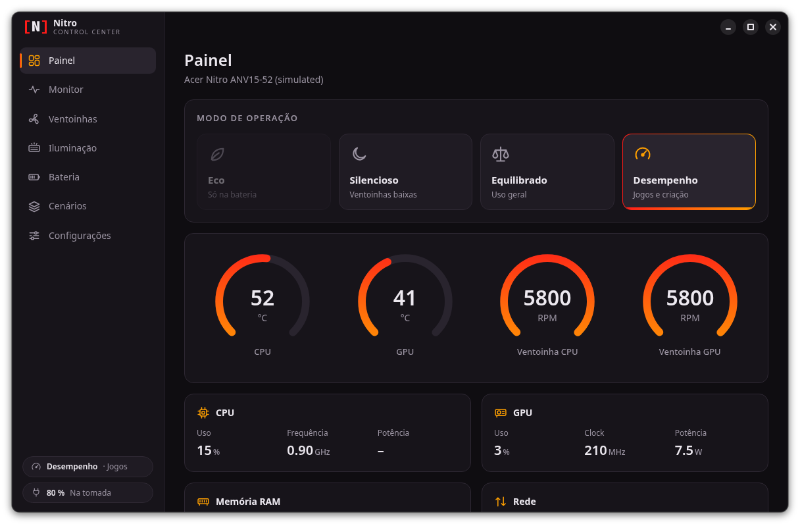
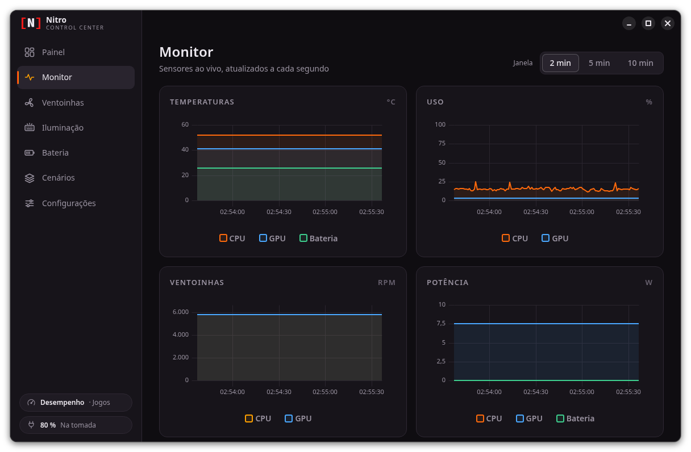
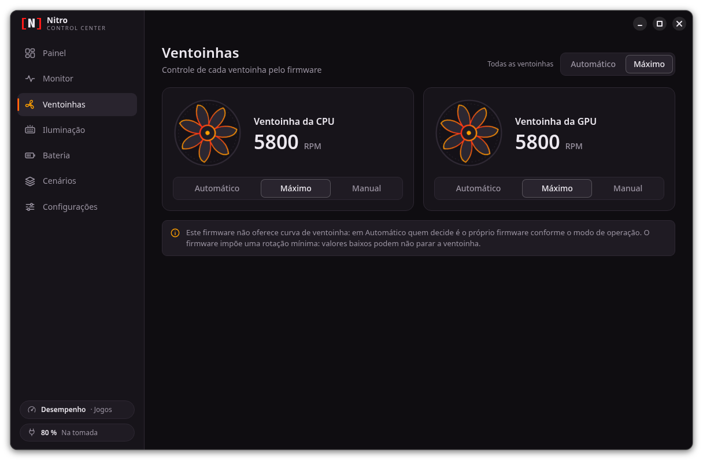
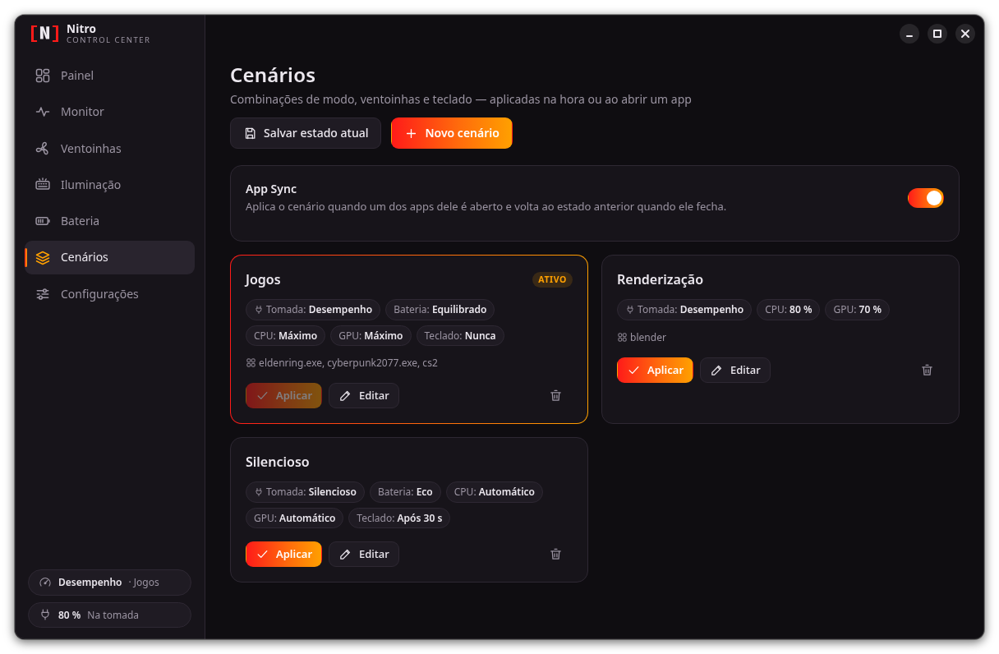
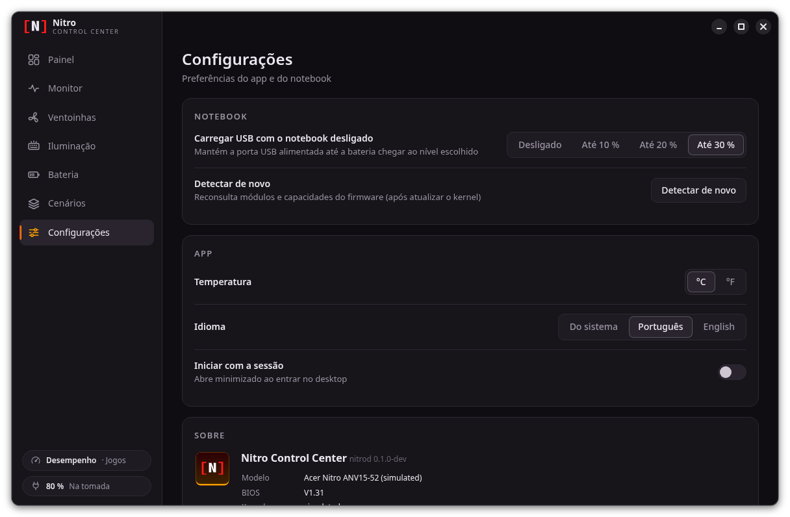

<p align="center"></p>

<h1 align="center">acerctl</h1>

<p align="center">All-in-one Linux alternative to Acer's NitroSense, AcerSense and PredatorSense: one daemon, CLI and app for operating modes, fans, battery, keyboard and sensors, showing only the features the laptop's firmware offers.</p>

Acer ships a different Windows-only app per product line: **NitroSense** (Nitro), **AcerSense** (Aspire, Swift and the other non-gaming lines) and **PredatorSense** (Predator). The laptops themselves share the same Acer WMI firmware interfaces (the ones the kernel's `acer_wmi` driver already uses across product lines), so acerctl covers all three with a single stack: each feature shows up only if the machine's firmware reports it, with no per-brand switch and no hard-coded model list.

| Windows app | Laptops | Status in acerctl |
|---|---|---|
| NitroSense | Nitro | working (reference machine: Nitro ANV15-52) |
| AcerSense | Aspire, Swift, TravelMate, Extensa | in progress (Aspire AG15-71P) |
| PredatorSense | Predator | to do |

Your model is not on the list? Run the read-only [hardware report](docs/hardware-reports.md) and open a *Hardware report* issue: that is all we need to start supporting it.

acerctl works **by complementing the in-tree `acer_wmi` driver** instead of replacing it: what the kernel lacks comes from small companion modules, a daemon applies the rules, and an app and a CLI (`acerctl`) talk to it over D-Bus. The app comes in two flavors built from the same code, differing only in name and colors: `Nitro Control Center` (red) for Nitro/Predator and `Acer Control Center` (green, planned) for the other lines.

> Independent open-source project, not affiliated with Acer. "Acer", "Nitro", "Predator", "Aspire", "NitroSense", "PredatorSense" and "AcerSense" are trademarks of Acer Inc., mentioned only to identify the hardware.

## What it does

- **Operating modes** (Eco, Quiet, Balanced, Performance, Turbo), limited to the profiles the firmware supports, with the original app's AC/battery rules and sync with the desktop's `power-profiles-daemon`/`tuned`.
- **CPU and GPU fans** in auto, max or manual speed.
- **Monitor** for temperatures, usage, clocks, power, fan speed, RAM and network, without waking the discrete GPU when it is powered off.
- **Battery:** 80 % charge limit, calibration, health, cycles, temperature, voltage and current.
- **Keyboard:** backlight auto-off timeout. **USB:** charge devices while the laptop is off.
- **Scenarios** combining mode, fans and keyboard, and **App Sync**, which applies a scenario when a game or program starts (including through Wine/Proton) and restores the previous state when it exits.
- **Sense key** (the NitroSense/AcerSense button) opening the app or cycling the modes; state restored at boot and after suspend.

## Nitro Control Center



| | |
|---|---|
|  |  |
|  |  |
|  |  |

<sub>Screenshots taken with the daemon in simulated mode (`acerd --simulate ANV15-52`).</sub>

The app uses its own dark theme, with an integrated title bar that follows GNOME's button order and icons, and texts in Portuguese and English.

## Compared with other tools

| Project | Features |
|---|---|
| `acer_wmi` (in-tree kernel driver) | Thermal profiles in `platform-profile` (fixed list of 5, without reading the firmware mask), fan RPM and temperatures in hwmon, max/manual fans via `pwm` (only with the model quirk or `force_caps`), Fn hotkeys and keyboard backlight events, wireless/rfkill. No battery, USB charging or backlight timeout; no user-space rules (AC/battery). |
| [acer-wmi-battery](https://github.com/frederik-h/acer-wmi-battery) (kernel module) | 80 % charge limit (health mode), battery calibration, battery temperature. Vendored here with a fix and the `charge_control_end_threshold` hook that GNOME/UPower use. |
| [Linuwu-Sense](https://github.com/0x7375646F/Linuwu-Sense) (kernel module, replaces `acer_wmi`) | Thermal profiles, CPU/GPU fan speed, 4-zone RGB keyboard with effects, 80 % charge limit, battery calibration, backlight timeout, boot sound, LCD overdrive, USB charging while off. |
| [Div-Acer-Manager-Max](https://github.com/PXDiv/Div-Acer-Manager-Max) (GUI + daemon on top of Linuwu-Sense) | Thermal profiles adjusted to AC/battery, auto/manual fans, LCD overdrive, backlight timeout, boot animation and sound toggle, live system info. |
| [predator-sense](https://github.com/wobqqq/predator-sense) (CLI + DKMS on top of Linuwu-Sense) | Thermal profiles, Turbo button as an on/off toggle, auto/max/manual fans per fan, temperature and RPM readout, 80 % charge limit and calibration, RGB keyboard (zones, effects, brightness), USB charging while off, backlight timeout, Fn+F4 fix. |
| Acer NitroSense / PredatorSense (Windows only) | Operating modes with AC/battery rules, auto/max/custom fans, system monitor and widget, battery health (80 % limit, calibration), RGB/keyboard lighting where present, USB charging while off, boot sound, LCD overdrive, CPU/GPU overclocking on some models, scenarios and App Sync, Nitro/Predator key. |
| **acerctl** (this project: companion modules + `acerd` + Nitro Control Center + CLI, alongside `acer_wmi`) | Operating modes limited to what the firmware reports, with the original app's AC/battery rules and `power-profiles-daemon`/`tuned` sync; auto/max/manual fans per fan; monitor (temperatures, usage, clocks, power, RPM, RAM, network) without waking the dGPU; 80 % charge limit (shared with GNOME), calibration, health; backlight timeout; USB charging while off; scenarios and App Sync (Wine/Proton aware); configurable Sense key; tray; CLI; state restored at boot and after suspend. Not yet: RGB, boot sound, LCD overdrive, overclocking. |

<sub>Third-party features as listed in each project's README (October 2026).</sub>

## GNOME integration

acerctl doesn't replace GNOME's own power controls. It stays in sync with them, so you can use either side.

### Power mode

GNOME's power mode menu (quick settings and Settings → Power) talks to `power-profiles-daemon` or `tuned-ppd`. `acerd` keeps that profile in sync with the Acer mode in both directions. The app has 5 modes and GNOME has 3, so the mapping is many-to-one going to GNOME. Coming back, the power source decides the mode. A mode the firmware doesn't report (e.g. Turbo on the ANV15-52) is never picked.

App → GNOME:

| App mode | GNOME power mode |
|---|---|
| Eco | Power Saver |
| Quiet | Power Saver |
| Balanced | Balanced |
| Performance | Performance |
| Turbo | Performance |

GNOME → app:

| GNOME power mode | On AC | On battery |
|---|---|---|
| Power Saver | Quiet | Eco |
| Balanced | Balanced | Balanced |
| Performance | Turbo when allowed (supported, battery ≥ 40 %), otherwise Performance | Performance (flagged as extra) when battery ≥ 40 %, otherwise Balanced |

When the app changes the mode, it sets the GNOME profile first, waits for `tuned` to apply it, and then writes the real Acer mode. This avoids loops. Details are in `docs/api-dbus.md` §11.

### Battery health

`acer-wmi-battery` exposes the 80 % limit through the standard `charge_control_end_threshold` attribute (kernel ≥ 6.15). UPower therefore sees it, and GNOME shows its own **Settings → Power → Preserve Battery Health** switch. That switch and the app's 80 % limit are the same setting:

- Turning on "Preserve Battery Health" in GNOME sets the 80 % limit, and the app shows it on the next refresh.
- The app's limit goes through UPower when it's available, so GNOME's switch follows it and UPower doesn't revert it at startup. Without UPower, `acerd` writes the firmware directly.
- The limit is either 80 % or off (100 %). The firmware has no other values and no start threshold.

Tested with UPower 1.91.5 on Fedora 44.

## Components

| Directory | What it is |
|---|---|
| `gui/` | **Nitro Control Center** (Go + Wails, WebKitGTK): the graphical app. Details in `gui/README.md`. |
| `daemon/` | **`acerd`** (Go): D-Bus service `io.github.fnndk.Acerd1` on the system bus, with polkit; power, fan, lighting, battery, monitor, scenario and App Sync rules. API in `docs/api-dbus.md`. Includes the **`acerctl`** CLI. |
| `drivers/acer-wmi-extras/` | Companion module (GPL): keyboard backlight timeout, USB charging while the laptop is off, the thermal profiles the firmware actually supports, battery sensors. |
| `drivers/acer-wmi-battery/` | Charge limit (80 %) and calibration, vendored from Frederik Himpe's project with one fix (`UPSTREAM.md`). |
| `drivers/acer-wmi-lab/` | Research module that calls WMI methods through `sysfs`; only for mapping firmware. |
| `packaging/` | systemd units, D-Bus policy, polkit actions and install scripts. |

Mainline layer used: `acer_wmi` with `predator_v4=1` (profiles in `platform-profile`, fans and temperatures in hwmon) and, until the model's quirk lands upstream, `force_caps=0x1C26` to unlock manual fan control.

## Installation

Reference machine: Acer Nitro ANV15-52 with Fedora Silverblue 44. The scripts install to `/usr/local`, `/etc` and `/var/lib` (writable on Silverblue).

```bash
# 1. kernel modules (builds; signs with the akmods MOK when Secure Boot/lockdown
#    requires signed modules, otherwise they are used unsigned)
sudo sh packaging/build-sign.sh
sudo sh packaging/install-modules.sh          # or name the modules, e.g. acer-wmi-battery

# 2. acerd daemon + acerctl CLI
sh packaging/install-daemon.sh build          # needs Go
sudo sh packaging/install-daemon.sh install

# 3. Nitro Control Center app
sh packaging/install-gui.sh build             # needs Go, Node, Wails and libwebkit2gtk-4.1-dev
sudo sh packaging/install-gui.sh              # 'uninstall' removes it
```

`acer_wmi` options on the reference machine (`/etc/modprobe.d/acer-wmi.conf`):

```
options acer_wmi predator_v4=1 force_caps=0x1C26
```

Before enabling `platform-profile`, check the `tuned`/`power-profiles-daemon` profile: Linux's `performance` mode maps to Acer's Turbo, which not every model has.

Once installed: `acerctl status` shows the state; `acerctl help` lists the commands.

### Building a module by hand

Requires `kernel-devel` for the running kernel, `gcc` and `make`. With Secure Boot, sign with an enrolled MOK (the akmods one on Fedora):

```bash
make -C drivers/acer-wmi-extras
sudo /usr/src/kernels/$(uname -r)/scripts/sign-file sha256 \
  /etc/pki/akmods/private/private_key.priv /etc/pki/akmods/certs/public_key.der \
  drivers/acer-wmi-extras/acer-wmi-extras.ko
sudo insmod drivers/acer-wmi-extras/acer-wmi-extras.ko
ls /sys/devices/platform/acer-wmi-extras/
```

## Documentation

- `STATUS.md`: project state, what has been done and next steps.
- `docs/firmware-wmi.md`: technical reference for the firmware (WMI classes, formats, capabilities).
- `docs/api-dbus.md`: `acerd` D-Bus API.

## License

acerctl is free and open-source software under the GNU General Public License:

- **Daemon, CLI, tray, GUI and scripts** (`daemon/`, `gui/`, `packaging/`): [GPL-3.0-or-later](LICENSE).
- **Our kernel modules** (`drivers/acer-wmi-extras/`, `drivers/acer-wmi-lab/`): [GPL-2.0](drivers/LICENSE), as required for code that links against the Linux kernel.
- **`drivers/acer-wmi-battery/`**: GPL-2.0-or-later, the license of the upstream project ([its LICENSE](drivers/acer-wmi-battery/LICENSE)).

You can use, study, change and redistribute it; modified versions you distribute must stay under the same license and ship their source code.
